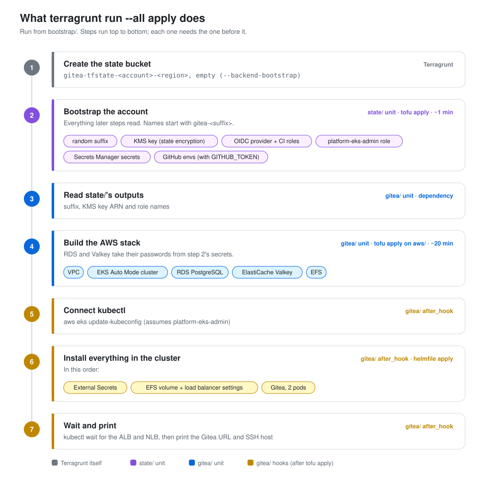
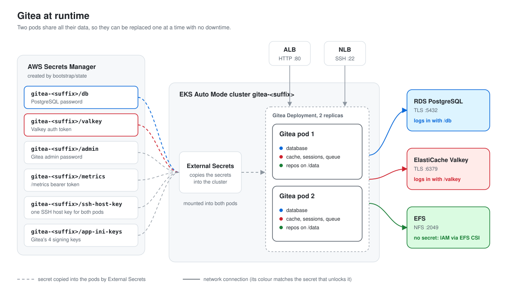

# gitea-template

Gitea on AWS with zero-downtime upgrades: EKS Auto Mode, RDS PostgreSQL, ElastiCache Valkey and
EFS, deployed with OpenTofu, Terragrunt and Helmfile.

```
aws/         OpenTofu: VPC, EKS, RDS, Valkey, EFS
helmfile/    everything inside the cluster (Gitea, External Secrets)
bootstrap/   Terragrunt config that ties it together, plus the one-time state/ setup
scripts/     the zero-downtime health check
docs/images/ the diagrams in this README
.mise.toml   pinned tool versions (mise install)
modules/     vendored terraform-aws-modules
```

## Before you start

- Admin AWS credentials for an empty AWS account in your shell (`aws sts get-caller-identity`).
- The AWS CLI, git and [mise](https://mise.jdx.dev) installed. For method 2 also `gh`.
- mise only reads a repo's `.mise.toml` after you trust it. Until then it prints
  `mise WARN ... .mise.toml is not trusted` and installs nothing, so every method below runs
  `mise trust` first.
- If the account already has a GitHub OIDC provider from another project, set
  `USE_EXISTING_GITHUB_OIDC_PROVIDER=true`. AWS allows only one, and we reuse it without
  managing it. Check with `aws iam list-open-id-connect-providers`.

## Method 1: everything from your laptop

```sh
git clone https://github.com/basenote-dev/gitea-template.git
cd gitea-template
mise trust
mise install
cd bootstrap
terragrunt run --all apply --backend-bootstrap --non-interactive
```

`--non-interactive` skips Terragrunt's "run apply in each unit?" prompt. `run --all` already
auto-approves each OpenTofu apply.

Tear down with `terragrunt run --all destroy` (keeps `state/`).

## Method 2: bootstrap from your laptop, then GitHub Actions deploys

```sh
git clone <your copy of this repo>
cd <it>
mise trust
mise install
cd bootstrap
GITHUB_TOKEN=$(gh auth token) terragrunt apply --working-dir state --backend-bootstrap
```

Then start the first deploy: Actions -> Gitea Deploy -> Run workflow -> `OpenTofu Apply`.
After that, every pull request gets a plan comment (OpenTofu plan and Helm diff), and every
merge to `main` deploys it. Tear down with Run workflow -> `OpenTofu Destroy`.

The workflow does nothing in a repository the bootstrap hasn't run for (a fresh clone, or this
template), so pushing first is harmless.

## What `terragrunt run --all apply` does



Terragrunt creates nothing itself. It writes a few files into each unit, runs `tofu` in the
units in the right order, and runs commands before and after (hooks). There are two units:
`state/` runs first and `gitea/` second, because `gitea/` reads `state/`'s outputs. With method
2, you run step 2 from your laptop and GitHub Actions runs steps 3 and 4.

1. Terragrunt creates the empty S3 bucket for OpenTofu state (`--backend-bootstrap`).
2. `state/` runs `tofu apply` on `bootstrap/state/`, which takes about a minute. It creates:
   - A random suffix. Every AWS name below starts with `gitea-<suffix>`, so a rebuild never
     collides with names an earlier build left behind.
   - The KMS key that encrypts the gitea unit's state.
   - The GitHub OIDC provider and the `github-plan` and `github-apply` roles.
   - The `platform-eks-admin` role for `kubectl`.
   - The Secrets Manager secrets, with random values: database password, Valkey token, admin
     password, metrics token, SSH host key and Gitea's signing keys.
   - With `GITHUB_TOKEN` set, the GitHub environments and variables.
3. `gitea/` reads those outputs (suffix, key, role names), then runs `tofu apply` on `aws/`,
   which takes about 20 minutes. It creates the VPC, the EKS Auto Mode cluster, RDS
   PostgreSQL, Valkey and EFS. RDS and Valkey read their passwords from the secrets made in
   step 2, which is why `state/` has to run first.
4. Hooks in `bootstrap/gitea/terragrunt.hcl` run after that apply:
   1. `aws eks update-kubeconfig` adds the cluster to `~/.kube/config`.
   2. `helmfile apply` installs External Secrets (it copies the secrets into the cluster), the
      EFS volume and load balancer settings, then Gitea with 2 pods.
   3. `kubectl wait` waits for the load balancers, then the URL and SSH host are printed.

### Where the Terragrunt config lives

Three files hold all of it. Read them in this order:

1. `bootstrap/root.hcl` is shared by both units. `remote_state` says which bucket holds state,
   and `generate "provider"` writes the AWS provider into each unit.
2. `bootstrap/state/terragrunt.hcl`: `terraform { source }` says which OpenTofu folder the unit
   runs, and `inputs` are the variables it passes.
3. `bootstrap/gitea/terragrunt.hcl` does the same for the gitea unit. It also has
   `dependency "state"` (reads `state/`'s outputs, so `state/` runs first),
   `generate "encryption"`, and the hooks from step 4.

### See what it does

Run these from `bootstrap/`:

```sh
terragrunt dag graph                    # run order; "gitea" -> "state" means gitea needs state
terragrunt render --working-dir gitea   # the gitea unit's config with every value filled in
```

`render` needs `state/` applied first. It shows the `inputs` with the real suffix and role
names, and the generated `encryption.tf` with the real KMS key ARN.

After a run, `gitea/.terragrunt-cache/<hash>/<hash>/aws/` is the folder where `tofu` really
ran. It has a copy of `aws/` plus the three files Terragrunt wrote: `backend.tf`,
`provider.tf` and `encryption.tf`.

Add `--log-level debug` to any command to see every command Terragrunt runs: `tofu init`,
`tofu apply` and each hook.

## What a Gitea upgrade does



1. Change `gitea_version` in `aws/main.tf` in a pull request, one release at a time
   (1.26.3 -> 1.26.4 -> 1.27.3 -> 28.2.0).
2. The PR's plan comment shows the change. Merge it.
3. Helm starts one new pod. It gets traffic only after the load balancers see it healthy.
4. One old pod is told to stop. It serves 60 more seconds while traffic moves off it. Then it
   finishes open git operations and exits.
5. The same happens for the second pod. One pod is always serving.
6. On a minor or major upgrade, the first new pod updates the database tables. The old pod
   keeps working meanwhile.

The pods can swap one at a time because they share all data. Repos are on EFS. Users and
issues are in RDS. Sessions and cache are in Valkey. The SSH host key comes from Secrets Manager.

To roll back, don't lower the version. Gitea can't run on tables a newer version changed.
Restore the database with RDS point-in-time recovery instead.

Why it's built this way: [adrs/0001-zero-downtime-gitea.md](adrs/0001-zero-downtime-gitea.md).
Everything we built on top of the stock modules and charts:
[adrs/0002-what-we-built.md](adrs/0002-what-we-built.md).
What the bootstrap creates, and how pipelines and `kubectl` log in:
[adrs/0003-bootstrap-and-access.md](adrs/0003-bootstrap-and-access.md).

## Watch a zero-downtime upgrade

Run this from your laptop, with the same AWS credentials, while a rollout happens:

```sh
scripts/zero-downtime-upgrade-healthcheck.sh
```

It needs only the AWS CLI, git and curl. It finds the load balancers by their tags. It logs in
as the admin and makes a test repo and a temporary SSH key. Then five loops hit Gitea every 1-3
seconds: `/api/healthz`, `git ls-remote` over HTTP and SSH, a push over SSH, and an issue created
through the API. Every 5 seconds it prints each check's last result and ok/fail count:

```
04:12:20  healthz ok       9/0  https-ls-remote ok       3/0  ssh-ls-remote ok       3/0  ssh-push ok       2/0  api-write ok       3/0
```

Start it, merge an upgrade PR, and watch the counts. Ctrl-C prints the totals and the time of
any failure. Every result is kept in `zero-downtime-healthcheck-<time>.log`.

## Demo limitations

The pieces below are kept single to save cost. A Gitea upgrade touches none of them, and each
has a known production fix.

- The database is in one AZ. AWS maintenance or a failure takes it down for a few minutes.
  Multi-AZ (`db_multi_az = true`) cuts that to about 40 seconds. RDS Proxy would turn those
  seconds into slow requests instead of errors.
- Valkey is a single node. If it restarts, users are logged out and queued jobs are lost.
- HTTP only, on the load balancers' own hostnames. A domain would add HTTPS and a real SSH
  clone URL (Gitea's UI shows `git@localhost:...` without one).
