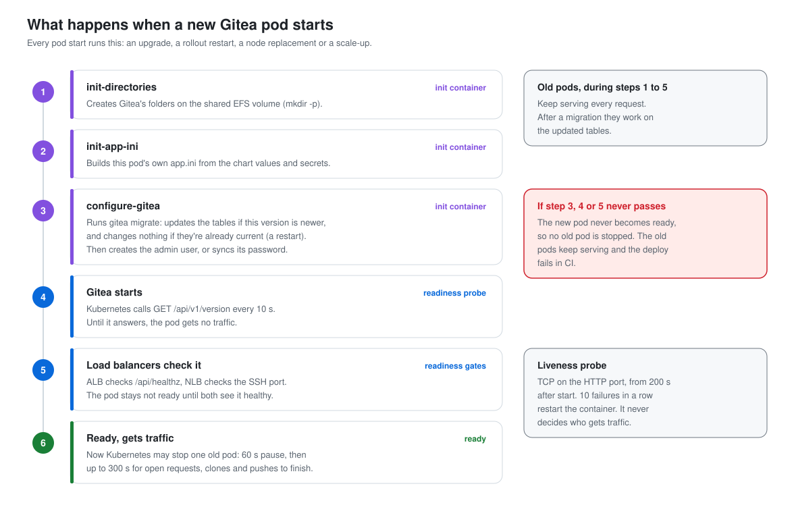

# Architecture Decision Record

Why the stack is built the way it is. Each section is one decision: what we needed, what we
chose, and what we turned down.

## What the assignment asked for

### Core

| Requirement | Status | How |
| --- | --- | --- |
| Gitea on a cloud provider | Done | AWS, us-west-2 by default |
| Containerized host | Done | EKS Auto Mode cluster, Gitea in 2 pods (official Helm chart, rootless image) |
| PostgreSQL, external and networked | Done | RDS PostgreSQL 17, private subnets, TLS only |
| Reverse proxy | Done | ALB for HTTP (Kubernetes Ingress), NLB for SSH |
| IaC with Terraform and Ansible | Done, with a change | OpenTofu (Terraform-compatible) plus Terragrunt and Helmfile. No Ansible: there are no servers to configure |

### Stretch

| Goal | Status | How |
| --- | --- | --- |
| Zero-downtime updates | Done | Rolling update of 2 pods with shared storage. Three upgrades measured with 0 failed requests (see "Upgrade tests") |
| Filesystem and data consistency | Done | Repos on EFS, data in RDS, sessions and locks in Valkey, shared keys. Migrations run once, before the new pod serves |
| ADR | Done | This document |
| Security hardening | Done | See "Security enhancements" below |
| Baseline observability | Done | CloudWatch Container Insights, EKS control plane logs, RDS logs. Gitea metrics on, not scraped |
| Production considerations | Documented | See "Before production" below |
| "yoink" in a code comment | Done | `helmfile/helmfile.yaml.gotmpl` |

## Run Gitea on EKS Auto Mode

The assignment asks for a containerized host. A single EC2 instance running Docker would meet
that, but upgrading it means stopping the one container, which rules out zero-downtime
upgrades. That needs at least two copies of Gitea and something that replaces them one at a
time while load balancers move traffic. Kubernetes does both.

Auto Mode is the EKS option where AWS runs the nodes, the load balancer controller and the
storage driver for block volumes. We don't patch or size nodes. The cluster asks for capacity
when pods need it.

## Two pods, with no state inside them

Gitea runs as 2 identical pods, and an upgrade replaces them one at a time. With one pod there
is always a gap while it restarts. A third pod would add cost without making upgrades any
safer.

Swapping pods one at a time only works if any pod can serve any request. So nothing that
matters lives inside a pod:

| State | Where | Why there |
| --- | --- | --- |
| Git repos, LFS files, attachments | EFS | Both pods need the same files at the same time |
| Users, issues, pull requests | RDS PostgreSQL | One database both pods use |
| Sessions, cache, job queues, locks | ElastiCache Valkey | Gitea keeps these in memory by default, so each pod would have its own and users would look logged out on the other one |
| Issue search index | RDS (Gitea's `db` indexer) | The default index (bleve) is a file that only one process can open |
| SSH host key, signing keys | Secrets Manager | Generated per pod, they differ, and SSH and logins fail on the other pod |

## EFS for the repos, not EBS, a hostPath or a StatefulSet

Gitea stores repos as plain git directories on disk, and both pods write to them: a push can
land on one pod and the next clone on the other. That needs a volume many nodes can mount at
once (ReadWriteMany).

- An EBS volume attaches to one node. We tested both ways it could work on this cluster. A
  shared EBS volume was refused (`ProvisioningFailed: Volume capabilities not supported`), and
  one volume for two pods on two nodes left the second pod stuck (`FailedAttachVolume: Volume
  is already used`). Keeping both pods on one node would make that node a single point of
  failure.
- EBS Multi-Attach works only inside one AZ, as a raw block device, with a cluster filesystem
  on top. That's more to run than the problem is worth.
- A StatefulSet gives each pod its own volume. Each pod would then have its own copy of every
  repo, and the copies would drift apart.
- A hostPath volume ties the data to one node and is lost with it.

EFS is a managed NFS file system that every node in the VPC can mount. Gitea's own HA guide
asks for a ReadWriteMany file system, and on AWS that means EFS, FSx for NetApp ONTAP, or NFS
you run yourself. EFS also keeps the repos outside the cluster, and AWS Backup copies them
daily. The cost is speed: EFS is slower than a local disk for very large repos.

## PostgreSQL on RDS, not in the cluster

The assignment prefers an external, networked database. RDS gives backups, point-in-time
recovery and patching without running Postgres ourselves, and the data survives if the cluster
is rebuilt. The Gitea chart can install Postgres and Valkey inside the cluster, but then the
data lives and dies with the cluster.

## ALB and NLB as the reverse proxy

The assignment asks for a reverse proxy. The ALB is one: it ends client connections, checks pod
health on `/api/healthz`, and spreads HTTP across the pods. It's also where HTTPS would
terminate once there's a domain. Git over SSH isn't HTTP, so it goes through an NLB instead.
Both are created by EKS Auto Mode from a Kubernetes Ingress and Service, so they follow the
pods during a rollout without anyone editing their config.

## OpenTofu, Terragrunt and Helmfile, not Ansible

The assignment names Terraform and Ansible. We use OpenTofu, the open-source fork of Terraform
that reads the same code, because it can encrypt state and plan files on the client. The state
holds endpoints and resource details, so it's encrypted with a KMS key before it reaches S3.

We left Ansible out because there's nothing for it to configure. Ansible's job is setting up
servers over SSH: packages, files, services. Here AWS runs the nodes, and everything on them is
a container whose config is in Helm values. Adding Ansible would mean a second way to configure
the same things.

- OpenTofu creates everything in AWS (`aws/`).
- Helmfile installs everything inside the cluster (`helmfile/`).
- Terragrunt ties them together: it sets up the state backend, runs OpenTofu in order, and runs
  Helmfile from hooks, so one command deploys the whole stack.

## Zero-downtime rollout settings

Every setting below closes one way a request could fail during an upgrade.

| Setting | What would fail without it |
| --- | --- |
| `maxSurge: 1`, `maxUnavailable: 0` | An old pod could stop before its replacement is ready |
| Readiness probe on `GET /api/v1/version` | The stock TCP check passes on a pod whose Gitea is broken |
| Readiness gates | A pod could count as ready before the load balancers send it traffic, so the next old pod stops too early |
| `preStop: sleep 60` | A stopping pod refuses new connections while load balancers still route to it (a 15-second pause still dropped one) |
| 300 s graceful shutdown, 300 s load balancer drain, 360 s grace period | Long clones and pushes are cut when the pod exits |
| Disruption budget `minAvailable: 1` | A node replacement could take both pods at once |

### How a new pod proves it's ready

A pod gets traffic only after three checks pass, in this order:

1. Its init containers finish. The last one, `configure-gitea`, runs `gitea migrate` and then
   creates or updates the admin user. Gitea itself doesn't start until they're done.
2. The readiness probe passes. Kubernetes calls `GET /api/v1/version` every 10 seconds, and 3
   failures in a row mark the pod not ready again. That endpoint answers only when Gitea and its
   database connection work. The chart's stock probe only opens a TCP connection to the port,
   which also succeeds on a Gitea that's up but broken.
3. The readiness gates pass. EKS Auto Mode adds one gate per load balancer, and each turns true
   only when the ALB (checking `/api/healthz`) or the NLB (checking the SSH port) sees the pod as
   healthy. Without the gates, Kubernetes could call the pod ready while the load balancers
   still send it nothing, and stop an old pod too early.

Only then does Kubernetes stop one old pod, and `maxUnavailable: 0` means it never stops one
before that.

The liveness probe is separate. It opens a TCP connection to the HTTP port, starting 200
seconds after the pod starts, and 10 failures in a row restart the container. It catches a
Gitea that has hung, and it has no say in who gets traffic.

### Database migrations

The first new pod's `configure-gitea` runs `gitea migrate` before Gitea starts. If the new
version changes the tables, this is where it happens, while the old pods keep serving. Gitea
versions are built so the old version keeps working on the migrated tables until it's
replaced, and both upgrade tests confirmed that. With `maxSurge: 1` only one new pod starts at
a time, so the second new pod finds nothing left to migrate.

If the migration fails, `configure-gitea` retries and the pod never becomes ready. No old pod
is stopped, the old pods keep serving, and the deploy fails in CI.

The init containers run on every pod start: an upgrade, a `kubectl rollout restart`, a node
replacement or a scale-up. That's harmless. When the tables already match the running version,
`gitea migrate` checks and exits without changing anything, and the admin step only re-syncs
the password from Secrets Manager.

To roll back, restore the database to before the upgrade with RDS point-in-time recovery.
Lowering the version doesn't work, because Gitea won't start on tables a newer version changed.

## Fixes for a brand-new install

An upgrade starts one pod at a time. A brand-new install starts both at the same second on an
empty volume, and that caused races we fixed:

- Each pod gets its own `app.ini`. With one shared file, a pod read it half written.
- Gitea's folders are created before Gitea starts, so two pods never race to create them.
- The SSH host key and Gitea's signing keys are generated once by the bootstrap and shared,
  where Gitea would generate a set per pod.
- OAuth2 signs with the shared `JWT_SECRET`, so there's no key file to race on.

## No stored AWS keys

GitHub Actions logs in to AWS with OIDC. Each job trades a short-lived GitHub token for role
credentials that last about an hour. The role's trust policy accepts only this repo, by its
numeric IDs, and only the job's GitHub environment. Plans run as a read-only role from any
branch. Deploys run as the admin role, and only `main` can use that environment.

People reach the cluster through one shared role, `platform-eks-admin`, so no one's personal or
SSO role is written into the cluster's access list.

## Secrets that never appear in state

The bootstrap generates every password and key as an ephemeral value and writes it to Secrets
Manager with write-only arguments. RDS and Valkey read theirs the same way. External Secrets
copies them into the cluster at run time. No secret value is in Git, in OpenTofu state, or in
plan output.

## Security enhancements

The stock setup would work without these. Each one closes a way an attacker, or a mistake,
could get more access than Gitea needs.

### Gitea can't run as root

The rootless Gitea image already defaults to the `git` user (UID 1000), but an image default
can be overridden. The manifest enforces it on the Gitea container and all three init
containers (`containerSecurityContext` in `helmfile/values/gitea.yaml.gotmpl`):

| Setting | What it prevents |
| --- | --- |
| `runAsNonRoot: true` | The kubelet refuses to start the container as UID 0, whatever the image says |
| `runAsUser: 1000`, `runAsGroup: 1000` | Running as any other user. It matches the EFS access point's uid and gid |
| `allowPrivilegeEscalation: false` | Becoming root later through setuid binaries |
| `capabilities.drop: ["ALL"]` | Using any Linux capability, even as the non-root user |
| `seccompProfile: RuntimeDefault` (pod) | Calling syscalls the default container profile blocks |

On a running cluster, `kubectl exec -n gitea deploy/gitea -- id` prints `uid=1000(git)`.

The namespace enforces Pod Security `baseline` and only warns on `restricted`. The Gitea pods
already meet `restricted`, so enforcing it is a one-line change in
`helmfile/charts/gitea-cluster/templates/namespace.yaml` that would reject any future pod that
tries to run as root.

### Everything else

- Data stores are private. RDS, Valkey and EFS sit in private subnets, and each has a security
  group that accepts only the cluster.
- Traffic to the data stores is encrypted. RDS rejects connections without TLS
  (`rds.force_ssl`), and Valkey uses TLS plus an auth token.
- Data at rest is encrypted: RDS, Valkey, EFS, and the OpenTofu state, which is encrypted with
  a KMS key on the client before it reaches S3.
- The EFS access point limits pods to Gitea's folder.
- No secret value is in Git, state or plan output (see "Secrets that never appear in state").
- No AWS keys are stored in GitHub, and only `main` can deploy (see "No stored AWS keys").
- External Secrets can read only Gitea's six secrets.
- GitHub Actions are pinned to commit SHAs, so a moved tag can't change what runs.
- The ALB drops requests with invalid header fields.
- Open registration is off, and the admin password is random.

## A random suffix on every name

Some AWS names stay taken after a teardown: a KMS alias while its key waits out the 7-day
minimum before deletion, or roles and log groups that a cleanup missed. A rebuild with fixed
names failed with `AlreadyExists`. The bootstrap picks a random suffix once, keeps it in state,
and every name starts with `gitea-<suffix>`. The state bucket keeps a fixed name, because
Terragrunt needs it before any state exists.

## Observability kept to AWS's own tools

The baseline is CloudWatch: Container Insights for pod and node metrics and container logs, the
EKS control plane's API and audit logs, and the RDS logs. Gitea's Prometheus endpoint is on,
behind a token, but nothing scrapes it yet. We built a Prometheus and Grafana setup with
Gitea-specific alerts in a local cluster. We left it out of this repo, because every piece we
automated for high availability had brought its own surprises, and monitoring would have added
more for a demo.

## Kept small to save cost

The demo is about upgrades without downtime, so the parts an upgrade never touches are single:
one RDS instance in one AZ, one Valkey node, one NAT gateway, and no domain. "Before production"
below lists what each would take.

## Upgrade tests

`scripts/zero-downtime-upgrade-healthcheck.sh` ran from before each merge until after the last
pod was replaced. It checks `/api/healthz` every second, and every 1 to 3 seconds it runs
`git ls-remote` over HTTP and SSH, pushes a commit over SSH, and creates an issue through the
API.

| Upgrade | Checks | Failed |
| --- | --- | --- |
| 1.26.3 to 1.27.3 (minor) | 829 | 0 |
| 1.27.3 to 28.2.0 (major) | 866 | 0 |
| 1.26.3 to 1.26.4 (patch) | 960 | 0 |

A gap shorter than the check interval could fall between two checks.

## Before production

| Gap in the demo | What production would do |
| --- | --- |
| HTTP only, no domain | A domain, an ACM certificate on the ALB, and a real SSH clone URL |
| RDS in one AZ | Multi-AZ (about 40 seconds of failover instead of minutes), RDS Proxy to absorb failovers |
| One Valkey node | A replica with automatic failover |
| Pods can share a node | Require spreading across nodes and AZs |
| `allowed_cidrs` is open to the internet | Limit it, and add AWS WAF on the ALB |
| Public EKS API endpoint | Private endpoint, or a list of allowed CIDRs |
| CI deploy role is a full admin | Scope it to the services the stack uses |
| Every account admin is cluster admin | A read-only role for most people |
| Nothing scrapes Gitea's metrics | Prometheus and Grafana, with alerts on health checks, database and cache |
| One environment | Separate staging and production accounts, promoted through the same pipeline |
